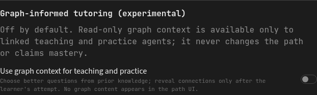
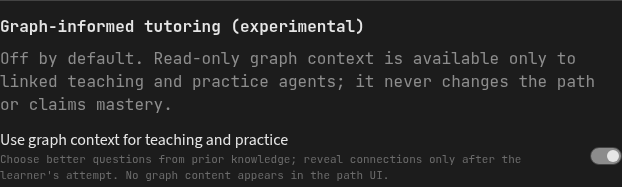

# Live graph-informed tutoring evidence

## Method and limits

Captured actual native LearnHarness 0.6.1 sessions against an isolated local copy of the user's deployed host. Conversation model: configured `custom/gpt-6-sol`. The learner inputs below were **automated synthetic test inputs**, not a human-learning study. Assistant text and native problem statements below are actual captured model output, not illustrative dialogue.

Tested backend SHA256: `87b7cfa28f8656d435f8866adef60379c8fe52a71fbe6b1b2e4cafd89c1a8111`.

- Existing chats/knowledge graph stayed private; production was accessed read-only for copying and was never modified by the test host.
- Invented **Velora** notes were added to the isolated copy through the supported notes-import API (7 new propositions, 3 chains). No original graph records were edited. Original substantive ledger bytes remain intact as prefixes.
- The synthetic unit's title/source anchor were simply “Velora,” with goal “Velora.” The opening prompt contained **no operation definitions or graph propositions**. Every retrieved entry used in these excerpts came from the synthetic fixture, verified privately by proposition IDs.
- Built-in native graph readers were disabled through the isolated host's supported settings API. Practice obtained the toy-system facts through `learning_path_get_brief`, not `list_sessions`, `list_propositions`, learner-supplied answers, or source-file reads.
- Raw native records and SSE traces remain private outside the repository. Tool responses, hidden model solutions, reasoning, identifiers, source paths, and all original chat/graph text are omitted here.
- The teaching session reached Teacher through a real native `probe_done` and automatic transition, without fabricated messages or tool results. Its setup/probe exchanges began on an earlier candidate bundle; the map-review turn quoted below re-read the brief and executed graph search on the final corrected bundle named above. The four Practice turns, the separate recall exchange, and off/default/Prober checks were run on that final bundle.

## 1. Graph-informed reasoning check; feedback only after the attempt

This first example supplies operation definitions and tests their implications; it is **not a prior-memory recall check**. The separate [genuine recall exchange](recall-check.md) asks about a recorded operation without first supplying its definition or invariant.

The first Practice turn called `learning_path_get_brief`, received a bounded agent-only section with five synthetic graph entries, then called native `problem`. It did not state the total-preservation connection as an answer before asking. The hidden model solution was not shown to the learner.

**Automated learner, opening:**

> I want a short check from this unit. Ask one question at a time; wait for my attempt before feedback. I do not remember the details of this toy system.

**Practice, first problem:**

> Two sealed chambers start with $7$ beads on the left and $5$ on the right. A **transfer** moves one existing bead from one chamber to the other; a **creation pulse** adds one new bead to the left chamber. After two operations, the chambers contain $7$ beads on the left and $6$ on the right.
>
> Could both operations have been transfers? Explain briefly.

**Automated learner, submitted attempt:**

> No. Initial total is 12 and final total is 13. Transfers move existing beads without changing that total, so two transfers cannot produce this final pair.

**Practice, native conclusion after that attempt:**

> Correct. You compared the initial and final totals and used the fact that transfers preserve the combined bead count.

## 2. Unlabelled transfer to a fresh everyday setting

**Automated learner:**

> Next problem please. Use a different everyday setting without naming these operations or giving me the method.

**Practice, next problem:**

> At a café, two tip jars initially hold $4$ coins and $6$ coins. During a shift, staff may move a coin from one jar to the other, or put a new coin into the left jar; no coins are removed.
>
> Two possible end-of-shift records are **A:** $(5,5)$ and **B:** $(5,6)$, with the left jar listed first. For each record, say whether it could result from moving coins between the jars alone, and explain briefly.

This problem does not name Velora, transfer/pulse labels, or a conservation method; the learner has to identify the relevant relation. Its quantities and setting differ from the first problem.

**Automated learner, submitted attempt:**

> Record A can: move one existing coin from right to left, keeping total 10. B cannot come only from moving coins, because 5+6=11 means a new coin was added.

**Practice, conclusion after that attempt:**

> Correct. You identified a move producing A and ruled out moves alone for B by comparing the combined counts.

The native problem tool ends each posing turn. Both conclusions occurred only in later turns after the corresponding automated learner submission.

## 3. Learner-produced map, then Teacher review against the graph

The Teacher had asked for the learner's own labelled map. The following response was submitted before the Teacher's review. On this review turn the Teacher called **both** `learning_path_get_brief` and `learning_path_search_graph` with the synthetic topic, then gave feedback. Retrieved entries were bounded to five and were all from the synthetic notes.

**Automated learner, actual map attempt:**

> Here is my independently written map: moving an existing bead left-to-right → left count -1 and right count +1 → combined count unchanged; moving right-to-left reverses the signs → same total. Creating one new bead → left count +1 and right count unchanged → combined count +1. Both branches feed T=L+R; transfers change distribution but a pulse changes quantity. This connects to the earlier sealed-pair rule in the toy notes. Please review this actual map against the current node brief and search Velora read-only now, after my attempt; mention any missed link or false analogy.

**Teacher, post-attempt review:**

> Your map matches the specification’s links: each transfer moves an existing bead between chambers, so its two count changes cancel; a pulse adds a bead without removing one, so the total rises. Your connection to the sealed-pair rule is sound. I see no false analogy.
>
> One link worth making explicit in your map is **“creation pulse is not a transfer”**: the difference is what happens to the bead, not merely that both operations can raise the left count. The concrete changes $(4,3)\to(5,2)$ and $(4,3)\to(5,3)$ separate those cases.

The review checked the submitted map and identified a missing explicit distinction. **No incorrect link was deliberately planted**, so this is evidence of map review/missed-link feedback, not a claim that false-analogy correction was tested. Search was explicitly requested in the automated input; successful execution is observed, but spontaneous search selection is not claimed. The later unrelated symbolic quiz is omitted.

## 4. Off/default, Prober, and opening-prompt checks

All checks below used the final corrected bundle and fresh native sessions:

| Check | Observed |
| --- | --- |
| Setting explicitly false | `learning_path_get_brief` returned no agent-only graph section; Practice had no graph-search call and asked for the missing specification rather than inventing rules. |
| Setting absent (default) | Brief contained no graph section. Practice said: “I read the brief. No graph-search tool is available in this session. I won’t invent Velora material or read files.” |
| Prober with plugin setting true | Prober read the linked brief with **no graph section** and asked for the source. No plugin graph-search call occurred. |
| Teacher/Practice when enabled | Both actually received graph context via their brief; Teacher successfully executed the read-only search tool. |
| Launch prompts | `sessions.prepare` output was graph-free in enabled, disabled, and Prober cases; graph context entered only through agent tool results. |

The live Prober observation does not alone prove capability absence: registration/scope tests cover that negative guarantee. No live Path Architect conversation was run; its unchanged capabilities are an automated-test/code-review check, not live inference evidence.

## 5. Settings UI

The actual host mounted the plugin settings with no browser `pageerror` events. The new toggle rendered off, was clicked on, became enabled again after save, and persisted `graphContextEnabled: true` through the plugin settings RPC. Both cropped screenshots were inspected; they contain only the graph-settings section, not private sidebar titles or source material.

This is a wide-screen render and toggle interaction, not an accessibility audit or a narrow-screen pass. No private full-window screenshot should be published.

## Reproduction boundary

Setup/import/native-session driver commands and original traces are retained privately. The public excerpts intentionally omit file paths, chat IDs and original user data. These finite successful samples do not establish universal prompt adherence, learning effectiveness, absence of all leakage, or false-analogy correction.
